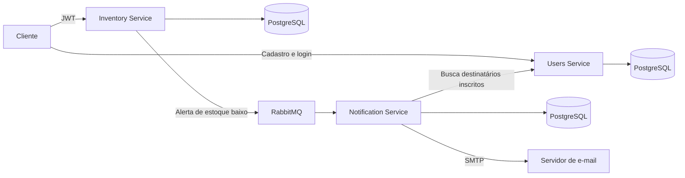

# StockVision

Backend para controle de produtos, locais e saldos de estoque. O repositório reúne três aplicações Spring Boot independentes: inventário, autenticação de usuários e notificações.

## Serviços

| Aplicação | Diretório | Porta padrão | Responsabilidade |
| --- | --- | ---: | --- |
| Inventory Service | `inventory/` | 8081 | Produtos, locais, saldos e movimentações |
| Users Service | `users/` | 8082 | Cadastro, login e emissão de tokens JWT |
| Notification Service | `notification/` | 8083 | Consumo de alertas de estoque baixo e envio de e-mails |

## Arquitetura



O Inventory Service publica um alerta quando uma saída deixa o saldo igual ou abaixo do mínimo registrado. O Notification Service consome o evento, consulta os usuários inscritos no Users Service e envia o e-mail. As migrations atuais inicializam o mínimo de estoque como zero.

## Tecnologias

- Java 21 e Maven
- Spring Boot, Spring Web, Spring Data JPA e Spring Security
- PostgreSQL e Flyway
- RabbitMQ para eventos de estoque baixo
- JWT com chaves RSA para autenticação
- Mailpit pode ser usado como servidor SMTP local

## Executar localmente

### Pré-requisitos

- JDK 21
- Docker
- PostgreSQL, RabbitMQ e, para testar e-mails, Mailpit

Suba os serviços de apoio em containers:

```bash
docker run -d --name stockvision-postgres \
  -e POSTGRES_USER=postgres -e POSTGRES_PASSWORD=postgres \
  -p 5432:5432 postgres:16-alpine

docker exec stockvision-postgres sh -c 'until pg_isready -U postgres; do sleep 1; done'
docker exec stockvision-postgres createdb -U postgres inventory_db
docker exec stockvision-postgres createdb -U postgres users_db
docker exec stockvision-postgres createdb -U postgres notification_db

docker run -d --name stockvision-rabbitmq \
  -e RABBITMQ_DEFAULT_USER=stockvision \
  -e RABBITMQ_DEFAULT_PASS=stockvision_dev_123 \
  -p 5672:5672 -p 15672:15672 rabbitmq:4-management

docker run -d --name stockvision-mailpit \
  -p 1025:1025 -p 8025:8025 axllent/mailpit
```

O Mailpit fica disponível em `http://localhost:8025`. As aplicações usam por padrão o PostgreSQL em `localhost:5432`, o RabbitMQ em `localhost:5672` e o SMTP em `localhost:1025`.

### Iniciar as aplicações

Abra um terminal para cada serviço. Os wrappers Maven ficam dentro de cada diretório:

```bash
cd inventory
SPRING_DATASOURCE_PASSWORD=postgres \
JWT_PUBLIC_KEY_LOCATION="file:$(realpath ../users/keys/public.pem)" \
./mvnw spring-boot:run
```

```bash
cd users
SPRING_DATASOURCE_PASSWORD=postgres \
JWT_PRIVATE_KEY_PATH="$(realpath keys/private.pem)" \
JWT_PUBLIC_KEY_PATH="$(realpath keys/public.pem)" \
./mvnw spring-boot:run
```

```bash
cd notification
SPRING_DATASOURCE_PASSWORD=postgres ./mvnw spring-boot:run
```

Cada serviço aplica suas migrations ao iniciar. URLs, credenciais e portas podem ser substituídas pelas variáveis `SPRING_DATASOURCE_URL`, `SPRING_DATASOURCE_USERNAME`, `SPRING_DATASOURCE_PASSWORD` e `SERVER_PORT`. A configuração de JWT do Inventory Service deve apontar para a mesma chave pública usada pelo Users Service.

## API

As rotas protegidas recebem o token no cabeçalho `Authorization: Bearer <token>`. Registre um usuário e faça login pelo Users Service para obter o token.

```bash
curl -X POST http://localhost:8082/v1/auth/register \
  -H 'Content-Type: application/json' \
  -d '{"name":"Ana Silva","email":"ana@example.com","password":"senha-segura-123"}'

curl -X POST http://localhost:8082/v1/auth/login \
  -H 'Content-Type: application/json' \
  -d '{"email":"ana@example.com","password":"senha-segura-123"}'
```

A resposta de login contém `accessToken`; use esse valor nas chamadas autenticadas.

### Produtos

O `ProductService` oferece listagem paginada, busca por ID, busca parcial de SKU sem diferenciar maiúsculas e minúsculas, criação, atualização e ativação. O SKU deve ser único.

| Método | Rota | Descrição |
| --- | --- | --- |
| `GET` | `/v1/products?page=0&size=10` | Lista produtos paginados |
| `GET` | `/v1/products/{id}` | Busca produto por ID |
| `GET` | `/v1/products/search?sku=CAF` | Busca por trecho do SKU; sem `sku`, lista todos |
| `POST` | `/v1/products` | Cria um produto |
| `PUT` | `/v1/products/{id}` | Atualiza um produto |
| `PATCH` | `/v1/products/{id}/activate` | Ativa um produto |

Exemplo de criação:

```bash
curl -X POST http://localhost:8081/v1/products \
  -H 'Authorization: Bearer SEU_TOKEN' \
  -H 'Content-Type: application/json' \
  -d '{
    "name": "Café em grãos",
    "sku": "CAF-001",
    "description": "Pacote de 500 g",
    "price": 49.90,
    "costPrice": 30.00
  }'
```

### Demais rotas

| Serviço | Método e rota | Descrição |
| --- | --- | --- |
| Users | `POST /v1/auth/register` | Cadastra usuário |
| Users | `POST /v1/auth/login` | Autentica e retorna JWT |
| Users | `PATCH /v1/users/me/notifications` | Alterna inscrição em notificações |
| Inventory | `GET, POST /v1/locations` | Lista e cria locais |
| Inventory | `GET, PUT, PATCH, DELETE /v1/locations/{id}` | Consulta, atualiza, alterna status ou remove local |
| Inventory | `GET /v1/stocks` | Lista saldos paginados |
| Inventory | `POST /v1/stocks` | Cria saldo para um produto e local |
| Inventory | `GET /v1/stocks/products/{productId}/locations/{locationId}` | Consulta saldo por produto e local |
| Inventory | `GET /v1/stocks/locations/{locationId}` | Lista saldos de um local |
| Inventory | `POST /v1/stocksMovement/addStock` | Registra entrada |
| Inventory | `POST /v1/stocksMovement/removeStock` | Registra saída |
| Inventory | `POST /v1/stocksMovement/adjusted` | Ajusta saldo |

O Swagger do Inventory Service está em `http://localhost:8081/swagger-ui/index.html`. As rotas da API exigem autenticação, exceto as rotas públicas de cadastro e login.

## Estrutura do repositório

```text
inventory/       API de catálogo e estoque
users/           autenticação e usuários
notification/    processamento de alertas e envio de e-mail
docs/            documentação e diagramas
docker-compose.yaml
```

Cada aplicação pode ser compilada individualmente, por exemplo, com `cd inventory && ./mvnw verify`.
